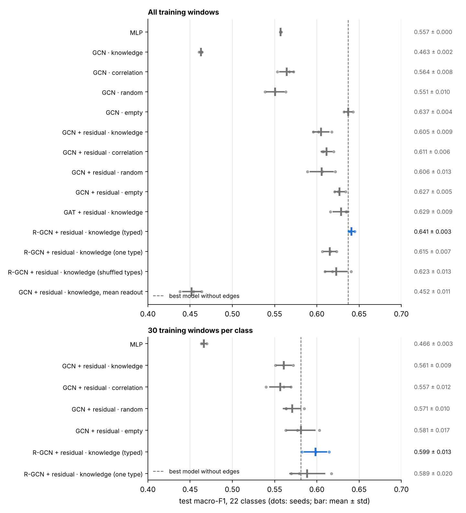

# Process knowledge as a graph for GNN fault diagnosis on the Tennessee Eastman process

Does engineering knowledge about a plant (which variables belong to the same unit, sit on the same material stream, or are tied by a control loop) help a graph neural network diagnose faults? This repository compares a graph built from that knowledge with a correlation graph, a random graph and no graph at all, using GCN, GAT and R-GCN layers in PyTorch Geometric on the Tennessee Eastman benchmark, with matched controls and three seeds per configuration.



## Findings

All results are for a single operating mode, with the same 21 faults in training and test, and three seeds per configuration.

1. **A per-sensor architecture beats a flat MLP.** Encoding each of the 52 sensors with one shared encoder plus a learned sensor embedding, with no edges at all, reaches about 0.63 macro-F1 against 0.56 for an MLP on the flattened window. With only 30 training windows per class the gap widens to about 0.58 against 0.47.
2. **A plain GCN over the knowledge graph is the worst model** (about 0.46). The knowledge graph is built from process units, so it consists of cliques; two GCN layers over it collapse the 52 sensors into about 8 distinct mixtures, roughly one per unit ([graph analysis](results/graph_analysis.md)). Fault 4, whose only clear symptom is the reactor cooling-water valve, falls from an F1 of 0.98 without edges to 0.32, and broad faults such as 6, 7 and 13 lose as well.
3. **Residual connections remove the collapse, but untyped edges then add nothing.** With h + GCN(h) instead of GCN(h), knowledge, correlation and random graphs score within each other's spreads, and all slightly below the model without edges.
4. **Typed edges come closest.** An R-GCN that treats unit, stream and control edges as different relations scores highest (about 0.64). It beats the same edges with a single type and with shuffled types (the latter with exactly the same number of parameters), but it is within noise of the best model without edges (about 0.637).
5. **Node identity matters.** Averaging the node vectors (mean readout) instead of concatenating them in a fixed sensor order drops the score to about 0.45.

In one operating mode, process knowledge does not yet improve diagnosis over a well-designed model without edges, and the way it enters the model decides whether it hurts. Whether typed knowledge helps when the operating regime changes, where data cover less of what knowledge describes, cannot be tested on this dataset and is the natural next step.

## Task and data

- **Data**: the Tennessee Eastman training and test runs of Chiang, Russell and Braatz (2001), downloaded automatically from a [public mirror](https://github.com/camaramm/tennessee-eastman-profBraatz) on first use (about 30 MB). 22 classes (normal and faults 1 to 21), 52 variables (41 measurements `XMEAS`, 11 manipulated variables `XMV`) sampled every 3 minutes.
- **Input**: windows of 20 consecutive samples (one hour) of all 52 variables.
- **Split**: training and validation windows come from the training runs, with validation the last 20% of each run after a 20-sample gap, so no window crosses the boundary. Test windows come from the separate test runs; in faulty test runs only windows after the fault onset (sample 160) are used. Standardisation statistics are computed on the training windows only.
- **Metric**: macro-F1 over the 22 classes on the test runs, also reported without faults 3, 9 and 15, which are practically unobservable in these variables. Mean ± standard deviation over seeds.

## The process-knowledge graph

The 52 variables are the nodes. The knowledge graph has 220 undirected edges of three types, listed edge by edge in [docs/knowledge_graph.md](docs/knowledge_graph.md):

| Edge type | Edges | Rule | Source |
|---|---|---|---|
| unit | 196 | all variables of one process unit are connected (7 units) | Downs and Vogel (1993) flowsheet |
| stream | 17 | an upstream and a downstream variable on the same material stream | flowsheet stream numbers |
| control | 20 | the variable a controller watches and the valve it finally moves | the closed-loop simulator code `temain_mod.f` |

Nineteen control loops are read from the simulator code by `extract_control_loops`; the twentieth is an override written as `IF` statements, added by hand.

Three control graphs separate the effect of the knowledge from the effect of having edges at all: a **correlation graph** (the 220 variable pairs with the largest absolute correlation in normal training data), a **random graph** (220 random edges) and an **empty graph** (no edges). For typed edges, two further controls use the same edges with **one type** and with **shuffled types**.

## Models and training

- **MLP**: the flattened window (1,040 numbers) through two hidden layers of 128 units.
- **SensorGNN** (`models.py`): each sensor's 20 values pass through one shared linear encoder (20 to 32), are joined with a learned 8-dimensional sensor embedding and mixed back to 32; two graph layers (GCN, GAT with 4 heads, or R-GCN), optionally residual; the 52 node vectors are concatenated in a fixed order and classified by a small MLP.
- **Training**: Adam (learning rate 10⁻³, weight decay 10⁻⁴), batch size 64, dropout 0.2, 40 epochs (200 in the 30-windows-per-class setting), keeping the epoch with the best validation macro-F1. No hyperparameter search; every model uses the same settings.

## Results

<!-- RESULTS:START -->
**All training windows (about 365 per fault)**

| Model and graph | Seeds | Macro-F1, 22 classes | Macro-F1 without faults 3, 9, 15 |
|---|---|---|---|
| MLP | 3 | 0.557 ± 0.000 | 0.624 ± 0.000 |
| GCN · knowledge | 3 | 0.463 ± 0.002 | 0.516 ± 0.003 |
| GCN · correlation | 3 | 0.564 ± 0.008 | 0.633 ± 0.011 |
| GCN · random | 3 | 0.551 ± 0.010 | 0.613 ± 0.010 |
| GCN · empty | 3 | 0.637 ± 0.004 | 0.711 ± 0.004 |
| GCN + residual · knowledge | 3 | 0.605 ± 0.009 | 0.672 ± 0.012 |
| GCN + residual · correlation | 3 | 0.611 ± 0.006 | 0.679 ± 0.005 |
| GCN + residual · random | 3 | 0.606 ± 0.013 | 0.675 ± 0.012 |
| GCN + residual · empty | 3 | 0.627 ± 0.005 | 0.696 ± 0.005 |
| GAT + residual · knowledge | 3 | 0.629 ± 0.009 | 0.697 ± 0.008 |
| R-GCN + residual · knowledge (typed) | 3 | 0.641 ± 0.003 | 0.712 ± 0.002 |
| R-GCN + residual · knowledge (one type) | 3 | 0.615 ± 0.007 | 0.686 ± 0.005 |
| R-GCN + residual · knowledge (shuffled types) | 3 | 0.623 ± 0.013 | 0.692 ± 0.013 |
| GCN + residual · knowledge, mean readout | 3 | 0.452 ± 0.011 | 0.506 ± 0.010 |

**30 training windows per class**

| Model and graph | Seeds | Macro-F1, 22 classes | Macro-F1 without faults 3, 9, 15 |
|---|---|---|---|
| MLP | 3 | 0.466 ± 0.003 | 0.523 ± 0.003 |
| GCN + residual · knowledge | 3 | 0.561 ± 0.009 | 0.626 ± 0.010 |
| GCN + residual · correlation | 3 | 0.557 ± 0.012 | 0.621 ± 0.015 |
| GCN + residual · random | 3 | 0.571 ± 0.010 | 0.634 ± 0.010 |
| GCN + residual · empty | 3 | 0.581 ± 0.017 | 0.645 ± 0.019 |
| R-GCN + residual · knowledge (typed) | 3 | 0.599 ± 0.013 | 0.668 ± 0.015 |
| R-GCN + residual · knowledge (one type) | 3 | 0.589 ± 0.020 | 0.656 ± 0.024 |
<!-- RESULTS:END -->

The figure above and these tables are generated by `make_report.py` from `results/results.json`.

## Limitations

- One operating mode, and the test faults are the faults seen in training: no unseen regimes, no unseen faults.
- Three seeds per configuration. Differences smaller than about two standard deviations should not be read as effects.
- No hyperparameter search, and a simple linear encoder over each window.
- One knowledge graph, written by hand. Some assignments are judgement calls (for example, stream 4 is assigned to the stripper), and the data show couplings it does not contain, such as the reactor, separator and stripper pressures ([graph analysis](results/graph_analysis.md)).

## How to run

```bash
pip install -r requirements.txt
python run_experiments.py --quick    # smoke test, about a minute
python run_experiments.py            # all experiments, 3 seeds: about 80 minutes on 2 CPU cores
python make_report.py                # tables, figure, graph analysis, README results block
```

Every finished run is written to `results/results.json` at once and skipped on the next start, so an interrupted run can be restarted. `--only "R-GCN" --seeds 0 1 2 3 4 5 6 7 8 9` runs a subset with more seeds.

On Google Colab:

```
!git clone https://github.com/Amir-Jaberi-eng/tep-knowledge-gnn.git
%cd tep-knowledge-gnn
!pip install -q torch_geometric
!python run_experiments.py --quick
```

The reference results were produced on CPU with Python 3.13, PyTorch 2.14.1, PyTorch Geometric 2.8.1, scikit-learn 1.9.1 and NumPy 2.5.3. Other hardware or versions can change results in the third decimal.

## Repository layout

| File | Contents |
|---|---|
| `tep_utils.py` | data download and loading, leakage-free windows and splits, standardisation, the four graphs, training and evaluation helpers, control-loop extraction |
| `models.py` | `MLP` and `SensorGNN` |
| `run_experiments.py` | every configuration over several seeds, resumable |
| `make_report.py` | results tables, figure, graph analysis, knowledge-graph listing |
| `results/` | `results.json` (every run), `results_table.md`, `scores.png`, `graph_analysis.md` |
| `docs/knowledge_graph.md` | the knowledge graph, edge by edge, with sources |

## How this was built

The code in this repository was written with substantial help from an AI coding assistant (Claude, Anthropic). I reviewed the process-knowledge graph, ran the experiments and checked the results reported here.

## References

- J. J. Downs and E. F. Vogel, A plant-wide industrial process control problem, *Computers and Chemical Engineering* 17 (1993) 245–255.
- L. H. Chiang, E. L. Russell and R. D. Braatz, *Fault Detection and Diagnosis in Industrial Systems*, Springer (2001).
- T. N. Kipf and M. Welling, Semi-supervised classification with graph convolutional networks, ICLR 2017.
- P. Veličković et al., Graph attention networks, ICLR 2018.
- M. Schlichtkrull et al., Modeling relational data with graph convolutional networks, ESWC 2018.
- K. He et al., Deep residual learning for image recognition, CVPR 2016.

## License

The code is released under the MIT License (see `LICENSE`). The Tennessee Eastman data are not redistributed here; they are downloaded from the mirror above and remain under the terms stated there.
